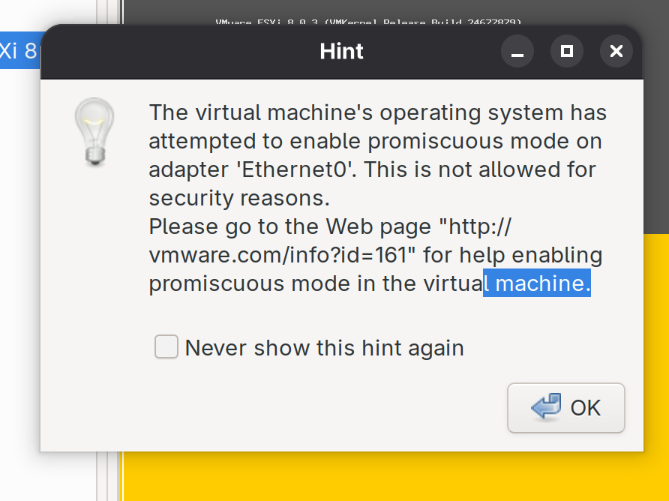
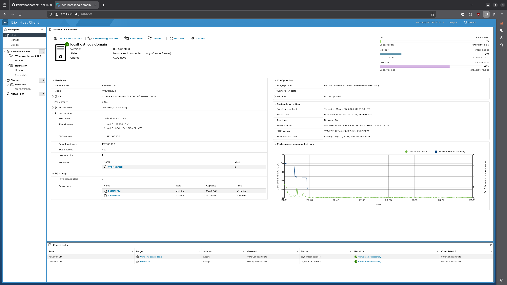
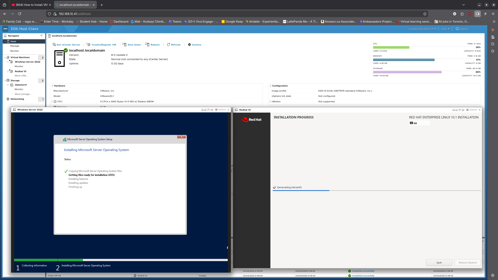
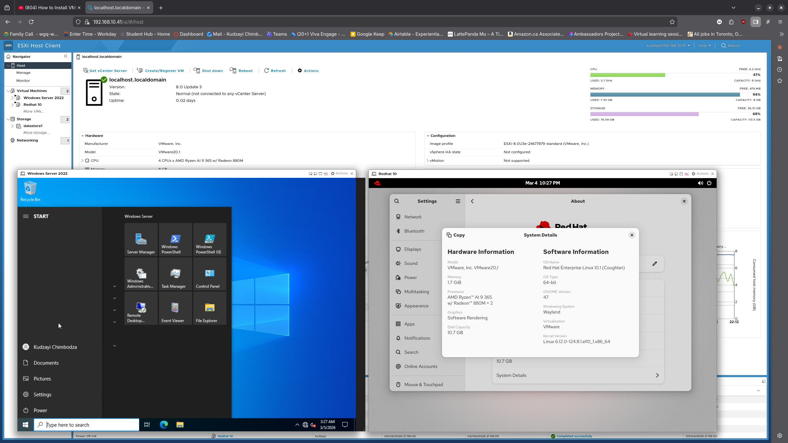

# ESXi Homelab — VM Provisioning & Network Setup

A hands-on lab demonstrating ESXi hypervisor deployment, virtual machine provisioning, and network configuration — skills directly applicable to NPI lab environments.

## Architecture

**Why this architecture**

| Choice | Why |
|---|---|
| Nested ESXi inside VMware Workstation | The whole lab (hypervisor, two guests, storage) runs on one laptop. |
| Bridged networking, not NAT | With NAT on Linux, ESXi fell back to a 172.x.x.x address the host browser could not reach. Bridged gives it a real 192.168.10.x address (details below). |
| A second 100 GB virtual disk as datastore2 | datastore1 is the 13.75 GB ESXi system disk; the two guests need 64 GB of disk between them. |
| Default vSwitch0 and "VM Network" port group | Both guests sit on the same bridged uplink and LAN as the host, which is all two VMs need. |
| One Linux and one Windows guest | Covers both server OS families from the skills table below. |

## Results

All numbers are read from the ESXi Host Client in the screenshots below (4 March 2026).

| Check | Result | Evidence |
|---|---|---|
| ESXi gets a LAN address and is managed from the browser | ✅ `https://192.168.10.41/` (DHCP), Host Client login works | Screenshots 1, 2 |
| Two guests install at the same time on one 8 GB host | ✅ Host at 36% CPU (2.9 of 8 GHz), 61% memory (4.85 of 8 GB) mid-install | Screenshot 3 |
| Both guests boot and run | ✅ "Power On VM" tasks completed successfully; RHEL 10.1 on kernel 6.12.0-124.8.1.el10, Windows Server 2022 at the desktop | Screenshots 2, 4 |
| Host load with both guests running | 47% CPU (3.7 GHz), **94% memory (7.53 of 8 GB, 479 MB free)** | Screenshot 4 |
| Storage | 76.99 of 113.5 GB used (68%); datastore2 has 34.17 GB free, datastore1 2.34 GB free | Screenshot 2 |

No automated tests: this is a hands-on lab, so the evidence is the screenshots.

## What worked and what didn't

| | What | Detail |
|---|---|---|
| ✅ | Bridged networking | ESXi took a DHCP lease (192.168.10.41/24, gateway and DNS 192.168.10.1) and was reachable from any LAN device. |
| ❌ → ✅ | NAT networking on Linux | ESXi ended up on an unreachable 172.x.x.x address. Fixed by switching to bridged mode. |
| ✅ | Parallel installs | Windows Server 2022 and RHEL 10.1 installed side by side on the same host. |
| ⚠️ | Memory is the limit | With both guests running, ESXi used 94% of its 8 GB. There is no room for a third VM without more RAM. |
| ⚠️ | Small system datastore | datastore1 has 2.34 GB free, so all VM disks went on the second 100 GB disk. |
| ⚠️ | Standalone host | Not connected to vCenter; the Host Client shows vMotion as "Not supported". |
| ⚠️ | No GPU in the guest | RHEL's About page shows "Software Rendering" for graphics. |
| ⚠️ | Built by hand | VMs were created in the Host Client; there are no scripts here (see [esxi-homelab-simulation](https://github.com/kchimbodza/esxi-homelab-simulation) for a scripted KVM version). |

---

## Environment

| Component | Details |
|---|---|
| Hypervisor | VMware ESXi 8.0 Update 3 |
| Host CPU | AMD Ryzen AI 9 365 |
| Host RAM | 8 GB allocated |
| Host IP | 192.168.10.41 (bridged to LAN) |
| Datastore 1 | datastore1 — VMFS6, 13.75GB (ESXi system partition) |
| Datastore 2 | datastore2 — VMFS6, 100GB (VM storage — secondary virtual disk) |
| Host OS | Nobara Linux (VMware Workstation) |

---

## What Was Built

### 1. ESXi Hypervisor Setup
- Deployed ESXi 8.0 U3 as a nested VM on VMware Workstation
- Configured network adapter in **bridged mode** to expose ESXi directly on the local LAN (192.168.10.0/24)
- Verified management network reachability via browser at `https://192.168.10.41`

#### Why Bridged Mode on Linux (not NAT)

On Windows, VMware's NAT engine runs as a privileged system service with deep kernel integration, allowing nested hypervisors like ESXi to negotiate through the NAT layer cleanly. On Linux, the NAT service (`vmnet-natd`) is more constrained by the kernel's network namespace handling — when ESXi boots inside a VM, it attempts to take control of its own network stack, which conflicts with VMware Workstation's NAT on Linux. This causes ESXi to fall back to a 172.x.x.x address that is unreachable from the host browser.

Switching to **bridged mode** bypasses this conflict entirely — VMware binds directly to the physical NIC (via `vmnet0`), placing ESXi on the same LAN subnet as the host. This gives ESXi a real 192.168.10.x address reachable from any device on the network, which is also the correct configuration for a lab environment where multiple devices need access to the hypervisor.

### 2. VM Provisioning
Two VMs were provisioned and installed in parallel on datastore2 (100GB secondary disk):

**RHEL 10.1 (Coughlan)**
- 2 vCPUs, 2GB RAM, 10GB disk
- Guest OS: Red Hat Enterprise Linux 10.1
- Kernel: Linux 6.12.0-124.8.1.el10
- Windowing: Wayland, GNOME

**Windows Server 2022 (Standard Evaluation — Desktop Experience)**
- 2 vCPUs, 4GB RAM, 54GB disk
- Guest OS: Microsoft Windows Server 2022
- Account: Kudzayi Chimbodza
- VMware Tools installed

### 3. Network Configuration
- Both VMs connected to VM Network port group on vSwitch0
- ESXi management interface assigned DHCP lease from local router (192.168.10.41/24)
- Verified ESXi reachability from host browser and other LAN devices
- Guest VM network adapters configured and connected at power-on

---

## Screenshots

| # | Description |
|---|---|
| 1 | ESXi 8.0 U3 boot screen in VMware Workstation — IP assigned, 8GB RAM, Ryzen AI 9 365 |
| 2 | ESXi web UI dashboard logged in as kudzayi — hardware, storage, and networking summary |
| 3 | Windows Server 2022 and RHEL 10.1 installing simultaneously — ESXi dashboard visible in background, CPU and memory under real load |
| 4 | Both VMs fully booted — Windows Server 2022 showing Kudzayi Chimbodza account, RHEL 10.1 (Coughlan) showing Linux 6.12 kernel and VMware virtualization confirmed |

---

## Key Concepts Demonstrated

- **Hypervisor deployment** — ESXi installation, management network config, web UI access
- **VM lifecycle management** — creating, configuring, and powering on VMs via ESXi
- **Network topology** — bridged vs NAT mode, port groups, virtual switches (vSwitch)
- **IP addressing** — DHCP lease acquisition, gateway connectivity, DNS resolution
- **CIDR / subnetting** — host on /24 subnet (192.168.10.0/24), correct gateway config
- **Storage management** — VMFS6 datastores, secondary disk provisioning, thin vs thick disk

---

## Skills Mapped to Industry Standards

| Industry Requirement | Demonstrated Here |
|---|---|
| Build VMs using ESXi hypervisor | ✅ Two VMs provisioned on ESXi 8.0 U3 |
| Set up and maintain network topologies | ✅ Bridged network, vSwitch, VM Network port group |
| Maintain Linux operating systems | ✅ RHEL 10.1 deployed and running |
| Maintain Windows operating systems | ✅ Windows Server 2022 deployed with VMware Tools |
| IP address / DNS / CIDR notation | ✅ DHCP, gateway config on 192.168.10.0/24 |
| Attention to detail | ✅ Documented each step with screenshots |

---

## Related Homelab Work

This lab is part of a broader homelab documented at [myviewsontech.com](https://myviewsontech.com), which includes:

- MQTT broker with TLS (Mosquitto)
- Alta Labs managed networking (R10 router, AP6 access point)
- ZimaOS NAS with 4x NVMe RAID 5

---

*Built by Kudzayi Chimbodza — MSc Cyber-Physical Systems, Northeastern University*  
*GitHub: [github.com/kchimbodza](https://github.com/kchimbodza)*
